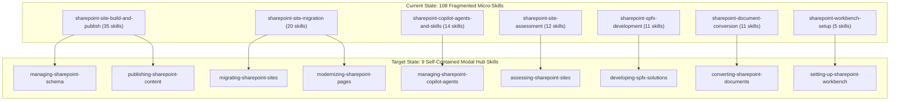

# SharePoint Knowledge Workbench: APM Migration & Skill Consolidation Analysis

**Branch:** `feat/apm-migration-and-skill-consolidation`  
**Repository:** `sharepoint-knowledge-workbench`  
**Date:** 2026-10-23  
**Status:** In Progress (Discovery & Architecture Phase)

---

## 1. Executive Summary & Diagnostic Findings

This analysis establishes the architectural migration blueprint for `sharepoint-knowledge-workbench`, transitioning it from a legacy, symlink-heavy micro-skill architecture to self-contained, APM-packaged domain hub skills.

### 1.1 Measured Repository Footprint
- **Domain Plugins:** 7 plugins under `plugins/`.
- **Total Skills:** **108 granular micro-skills** across the 7 plugins.
- **Internal Symlink Debt:** **783 symlinks inside skill folders**, pointing backward via relative paths (`../../../references/...` and `../../../scripts/...`) to parent plugin roots.
- **Copy-Manifest Sprawl:** `symlinks.json` contains **739 entries** maintaining cross-directory duplicates.
- **Legacy Harness Footprint:** `.agents/` contained 136 materialized skill copies, 31 agents, and 31 workflows (now removed from the working tree; gitignored).
- **Outdated Manifests:** Contains legacy `plugin-sources.json` (pointing to pre-consolidation `richfrem/agent-plugins-skills` plugins), `plugin-retention.json`, and `skills-lock.json`. Missing modern `apm.yml`.

### 1.2 The Core Problem: Why the Current Architecture Fails Under APM
When APM (or any standard agent packaging harness) installs a skill to `~/.agents/skills/<name>` or `~/.claude/skills/<name>`, it installs only the self-contained skill folder. In the current layout, **every single one of the 108 skills contains 4 to 15 broken relative symlinks** (`../../../references/...` and `../../../scripts/...`), rendering the installed skills non-functional outside this specific checkout.

Furthermore, 108 micro-skills create massive context clutter in agent tool navigation (Claude `/`, Codex `$`, Copilot `/`), forcing agents to navigate 35+ CRUD variations just for list and column definitions.

---

## 2. Skill Consolidation Blueprint: 108 Micro-Skills → 9 Domain Hubs

By grouping single-verb micro-tasks by domain entity and workflow, we collapse **108 fragmented skills down to 9 cohesive, self-contained skills** (a **~92% reduction** in skill noise).



---

## 3. Plugin-by-Plugin Consolidation Mapping

### Wave 1: `sharepoint-workbench-setup`
- **Current:** 5 skills (`workbench-initialize-connection-config`, `workbench-initialize-document-workflow`, `workbench-request-app-registration`, `workbench-resolve-document-paths`, `workbench-validate-sharepoint-connection`) + 47 symlinks.
- **Target:** **1 skill**: `setting-up-sharepoint-workbench`
- **Modes:**
  - `init-connection`: Sets up Layer 1 PowerShell connection configurations (`config.psd1`).
  - `validate-connection`: Validates tenant connectivity and credentials.
  - `app-registration`: Automates Microsoft Entra ID app registration requests.
  - `resolve-paths`: Resolves local document paths and directory mappings.
  - `workflow-intake`: Bootstraps document conversion workflows.

### Wave 2: `sharepoint-site-assessment`
- **Current:** 12 skills (permissions, page inventory, site navigation, schema drift, metadata, forms, webparts, reports) + 81 symlinks.
- **Target:** **1 skill**: `assessing-sharepoint-sites`
- **Modes:**
  - `inventory`: Collects full site structure, lists, and pages.
  - `permissions`: Audits permission levels, broken inheritance, and user groups.
  - `drift-audit`: Compares live schema against exported baselines.
  - `forms-webparts`: Inspects InfoPath/PowerApps forms and classic webparts.
  - `report`: Generates executive and technical assessment reports.

### Wave 3: `sharepoint-document-conversion`
- **Current:** 11 skills (extraction, structure analysis, template authoring, rendering, comparison, validation) + 180 symlinks.
- **Target:** **1 skill**: `converting-sharepoint-documents`
- **Modes:**
  - `extract`: Extracts text, tables, and images from source `.docx` files.
  - `analyze`: Classifies heading hierarchy and document semantics.
  - `template`: Generates and validates Markdown and SharePoint rendering templates.
  - `render-markdown`: Produces canonical GitHub-flavored markdown pages.
  - `render-sharepoint`: Prepares SharePoint modern client-side page payloads.
  - `compare-validate`: Runs diff comparisons and acceptance validation.

### Wave 4: `sharepoint-site-build-and-publish`
- **Current:** 35 skills (crud for columns, content types, lists, views, items, publication plans, publishing) + 183 symlinks.
- **Target:** **2 skills**:
  1. `managing-sharepoint-schema` (absorbs 24 skills):
     - Comprehensive management of site columns, list columns, content types, lists, views, list settings, and schema reconciliation plans.
  2. `publishing-sharepoint-content` (absorbs 11 skills):
     - Modern page publication plans, markdown-to-SharePoint page publishing, page validation, and cross-site page promotion.

### Wave 5: `sharepoint-site-migration`
- **Current:** 20 skills (legacy aspx conversion, wave planning, list migration, link remediation, reports) + 152 symlinks.
- **Target:** **2 skills**:
  1. `migrating-sharepoint-sites` (absorbs 10 skills):
     - Migration wave planning, inventory normalization, dependency analysis, and list content migration.
  2. `modernizing-sharepoint-pages` (absorbs 10 skills):
     - Classic-to-modern page conversion, legacy ASPX-to-HTML, link rewriting, rich text image replacement, and live preview rendering.

### Wave 6: `sharepoint-spfx-development`
- **Current:** 11 skills (webparts, master-detail, extensions, application/form customizers, toolchain, packaging, deploy) + 73 symlinks.
- **Target:** **1 skill**: `developing-spfx-solutions`
- **Modes:**
  - `toolchain-check`: Validates Node, Gulp, and Yeoman prerequisites.
  - `scaffold`: Scaffolds React webparts, list view command sets, or application customizers.
  - `serve-workbench`: Configures and launches hosted workbench debugging.
  - `package`: Bundles and packages solution `.sppkg` files.
  - `deploy`: Automates app catalog deployment and live tenant registration.

### Wave 7: `sharepoint-copilot-agents-and-skills`
- **Current:** 14 skills (agent templates, packaging, native skills deployment, backup, restore, verify) + 67 symlinks.
- **Target:** **1 skill**: `managing-sharepoint-copilot-agents`
- **Modes:**
  - `create-agent`: Author declarative agent packages and templates.
  - `native-skill`: Package, deploy, verify, and undeploy native SharePoint skills.
  - `backup-restore`: Automated backup snapshots and disaster recovery restoration for tenant agents.
  - `inspect-knowledge`: Inspect agent grounding, knowledge sources, and permissions.

---

## 4. Elimination of Broken Symlinks & Asset Re-homing

To satisfy APM portability requirements:
1. **Inlined Acceptance Criteria & Guides:**
   - The 783 symlinks pointing to `../../../references/*-acceptance-criteria.md` will be absorbed directly into the consolidated skills' `references/` directories or integrated into `SKILL.md` verification checklists.
2. **Dedicated Spoke Scripts:**
   - Scripts dedicated to specific domain operations move from the plugin root into `plugins/<plugin>/skills/<skill>/scripts/`.
3. **Shared PowerShell & Python Domain Utilities:**
   - Foundation libraries (e.g. `Get-WorkbenchConnectionConfig.ps1`, `PnPWrapper.ps1`) remain at `plugins/<plugin>/scripts/` or are packaged cleanly as shared plugin modules, invoked via consistent paths.
4. **Zero Symlinks Invariant:**
   - `symlinks.json` will be retired; no symlinks will be committed.

---

## 5. APM Integration Specification

A new declarative `apm.yml` will replace legacy manifests:

```yaml
version: "1.0"
name: "sharepoint-knowledge-workbench"
description: "SharePoint Modernization, SPFx, and Copilot Knowledge Engineering Workbench"

plugins:
  - path: "plugins/sharepoint-workbench-setup"
  - path: "plugins/sharepoint-site-assessment"
  - path: "plugins/sharepoint-document-conversion"
  - path: "plugins/sharepoint-site-build-and-publish"
  - path: "plugins/sharepoint-site-migration"
  - path: "plugins/sharepoint-spfx-development"
  - path: "plugins/sharepoint-copilot-agents-and-skills"

dependencies:
  # Global APM supplies agent-agentic-os, dev-utils, agent-orchestration, agent-memory
  profile: "workstation-global"
```

---

## 6. Execution Waves & Milestones

| Wave | Target Scope | Skill Reduction | Status |
| :--- | :--- | :--- | :--- |
| **Prep** | Purge `.agents/`, create feature branch, document analysis | — | **DONE** |
| **Wave 1** | `sharepoint-workbench-setup` | 5 $\rightarrow$ 1 | **READY** |
| **Wave 2** | `sharepoint-site-assessment` | 12 $\rightarrow$ 1 | Queued |
| **Wave 3** | `sharepoint-document-conversion` | 11 $\rightarrow$ 1 | Queued |
| **Wave 4** | `sharepoint-site-build-and-publish` | 35 $\rightarrow$ 2 | Queued |
| **Wave 5** | `sharepoint-site-migration` | 20 $\rightarrow$ 2 | Queued |
| **Wave 6** | `sharepoint-spfx-development` | 11 $\rightarrow$ 1 | Queued |
| **Wave 7** | `sharepoint-copilot-agents-and-skills` | 14 $\rightarrow$ 1 | Queued |
| **Post** | Retire `symlinks.json`, `plugin-sources.json`, `skills-lock.json` | — | Queued |
