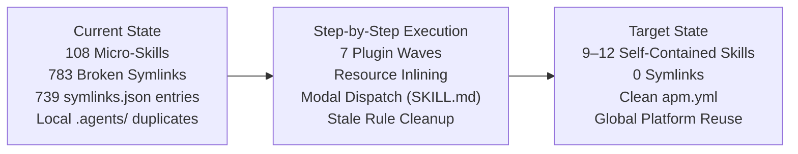

# SharePoint Knowledge Workbench: APM Migration & Skill Consolidation Plan

**Repository Target:** `sharepoint-knowledge-workbench` (`../sharepoint-knowledge-workbench`)  
**Parent Foundation:** `agent-plugins-skills` (`docs/plans/apm_migration_plan.md` §14)  
**Active Feature Branch:** `feat/apm-migration-and-skill-consolidation` (in `sharepoint-knowledge-workbench`)  
**Status:** DRAFT / READY FOR EXECUTION  
**Date:** 2026-10-23  

---

## 1. High-Level Plan & Strategic Objectives

The objective is to modernize `sharepoint-knowledge-workbench` by applying the battle-tested APM packaging and skill-consolidation model proven in `agent-plugins-skills` (PRs #715–#724).



### The 5 Strategic Pillars:
1. **Leverage Global APM (Zero Local Duplicates):**
   Downstream projects do not vendor or locally duplicate the core Agentic OS, dev-utils, memory, authoring, or orchestration plugins. All 30 platform skills are consumed directly from the global workstation profile (`~/.apm/apm.yml`).
2. **Eliminate All Symlinks via Self-Contained Spokes:**
   The 783 relative symlinks (`../../../references/...`, `../../../scripts/...`) inside skills break when APM installs them. Every script and reference needed by a skill moves **directly into that skill's own directory** (`plugins/<plugin>/skills/<skill>/scripts/` and `references/`).
3. **Consolidate 108 Micro-Skills into Cohesive Domain Hubs:**
   Group single-verb micro-tasks (e.g., 35 list/column CRUD skills) into cohesive domain hubs with modal execution (`SKILL.md` under 100 lines dispatching to `references/modes/<mode>.md`).
4. **Clean Stale Governance Rules:**
   Prune outdated rules in `.agent/rules/` inherited from earlier versions (e.g., remove `graph-planning-superpowers-policy.md`, repoint `agent-scaffolders` to `agent-extension-authoring`, retire symlink rules).
5. **Standardize on APM:**
   Retire `symlinks.json`, `plugin-sources.json`, `plugin-retention.json`, and `skills-lock.json`. Govern the project's SharePoint plugins through a native `apm.yml`.

---

## 2. Zero Functional Loss & 1:1 Parity Guarantee

Consolidation does **NOT** rewrite, delete, or degrade any underlying automation or script capability.

### 2.1 The Scripts Stay 100% Identical
- All PowerShell (`.ps1`) and Python (`.py`) scripts (e.g., `New-SharePointList.ps1`, `extract_docx.py`, `Get-WorkbenchConnectionConfig.ps1`) remain intact with identical arguments, parameters, return codes, and business logic.
- They simply move from plugin-root into the skill's `scripts/` folder (or stay in plugin root if truly shared), eliminating the broken relative symlinks.

### 2.2 What Actually Changes: The Front Door (Routing Layer)
- **Old (Fragmented):** 108 separate `SKILL.md` files. Each file is a thin wrapper over a single script, with 4–10 broken symlinks pointing outside the skill folder.
- **Consolidated (Modal Hub):** One authoritative domain `SKILL.md` acting as a **modal dispatcher**:
  - The detailed instructions, parameter guides, and examples from each old `SKILL.md` become verbatim reference files in `references/modes/<mode-name>.md`.
  - The agent triggers the skill and selects the exact mode needed.

```
Old Layout (5 Fragmented Skills):
├── skills/workbench-initialize-connection-config/SKILL.md -> (symlink ../../../scripts/Get-WorkbenchConnectionConfig.ps1)
├── skills/workbench-validate-sharepoint-connection/SKILL.md -> (symlink ../../../scripts/Test-SharePointConnection.ps1)
├── skills/workbench-request-app-registration/SKILL.md -> (symlink ../../../scripts/request_app_registration.py)
├── skills/workbench-resolve-document-paths/SKILL.md -> (symlink ../../../scripts/resolve_document_paths.py)
└── skills/workbench-initialize-document-workflow/SKILL.md -> (symlink ../../../scripts/initialize_workflow.py)

Consolidated Layout (1 Self-Contained Skill: setting-up-sharepoint-workbench):
├── SKILL.md  (concise router under 100 lines describing available modes)
├── scripts/
│   ├── Get-WorkbenchConnectionConfig.ps1
│   ├── Test-SharePointConnection.ps1
│   ├── request_app_registration.py
│   ├── resolve_document_paths.py
│   └── initialize_workflow.py
└── references/
    └── modes/
        ├── init-connection.md      (preserves verbatim old SKILL.md instructions)
        ├── validate-connection.md  (preserves verbatim old SKILL.md instructions)
        ├── app-registration.md     (preserves verbatim old SKILL.md instructions)
        ├── resolve-paths.md        (preserves verbatim old SKILL.md instructions)
        └── workflow-intake.md      (preserves verbatim old SKILL.md instructions)
```
**Net Result:** 0 broken symlinks, 0 broken scripts, 100% functional parity, and 80% less menu clutter.

---

## 3. Resource Re-homing: Eliminating Plugin-Root Drift & Symlinks

### The Root Cause:
In the legacy layout, shared scripts and references were authored at plugin roots:
- `plugins/<plugin>/scripts/` (~398 scripts total across the 7 plugins)
- `plugins/<plugin>/references/` (~218 references total)
Skills only contained symlinks pointing back to them. When installed by APM, those symlinks become dead pointers.

### The Re-homing Decision Matrix:
| Resource Type | Current Location | Target Location | Migration Rule |
| :--- | :--- | :--- | :--- |
| **Operation-Specific Script** (e.g. `export_choice_columns.py`) | `plugins/<plugin>/scripts/` | `plugins/<plugin>/skills/<hub-skill>/scripts/` | **Move directly into skill.** Eliminates symlink; makes skill self-contained under APM. |
| **Domain Reference / Criteria** (e.g. `*-acceptance-criteria.md`) | `plugins/<plugin>/references/` | `plugins/<plugin>/skills/<hub-skill>/references/` | **Move directly into skill.** Absorbed into skill modes and verification checklists. |
| **Shared Foundation Library** (e.g. `PnPWrapper.ps1`, `Get-WorkbenchConnectionConfig.ps1`) | `plugins/<plugin>/scripts/` | `plugins/<plugin>/scripts/` | **Retain as canonical plugin utility.** Invoked relatively or packaged cleanly; never symlinked. |
| **Plugin Architecture Manifest** | `plugins/<plugin>/.claude-plugin/plugin.json` | Same | **Update** to list only consolidated hub skills. |

---

## 4. Wave-by-Wave Skill Consolidation Blueprint

Total repository reduction: **108 micro-skills $\rightarrow$ 9–12 cohesive domain skills across 7 plugins**.

### Wave 1: `sharepoint-workbench-setup` (5 skills $\rightarrow$ 1 skill)
- **Current (5 skills, 47 symlinks):** `workbench-initialize-connection-config`, `workbench-initialize-document-workflow`, `workbench-request-app-registration`, `workbench-resolve-document-paths`, `workbench-validate-sharepoint-connection`.
- **Target Skill:** `setting-up-sharepoint-workbench`
- **Re-homed Resources:**
  - Moves `Get-WorkbenchConnectionConfig.ps1`, `request_app_registration.py`, `resolve_document_paths.py`, `initialize_workflow.py` into skill `scripts/`.
  - Re-homes 5 acceptance criteria files into `references/`.
- **Modes:** `init-connection`, `validate-auth`, `register-app`, `resolve-paths`, `workflow-intake`.

### Wave 2: `sharepoint-site-assessment` (12 skills $\rightarrow$ 1 skill)
- **Current (12 skills, 81 symlinks):** Inventory, permissions, page inventory, site navigation, schema drift, metadata, choice columns, calculated columns, forms, webparts, compare exports, reports.
- **Target Skill:** `assessing-sharepoint-sites`
- **Re-homed Resources:**
  - Moves assessment collectors and drift diff scripts from `plugins/sharepoint-site-assessment/scripts/` into skill `scripts/`.
  - Re-homes discovery templates and acceptance criteria into `references/`.
- **Modes:** `inventory`, `permissions`, `drift-audit`, `forms-webparts`, `calculated-choice`, `report`.

### Wave 3: `sharepoint-document-conversion` (11 skills $\rightarrow$ 1 skill)
- **Current (11 skills, 180 symlinks):** DOCX extract, document structure analysis, structured content assembly, rendering templates (MD & SP), page rendering (MD & SP), validation, output comparison, manual topic review.
- **Target Skill:** `converting-sharepoint-documents`
- **Re-homed Resources:**
  - Inlines extraction engine, AST structure analyzer, Jinja templates, and rendering validators into skill directory.
  - Eliminates 180 symlinks pointing to `references/assembly/` and `references/rendering/`.
- **Modes:** `extract`, `analyze`, `template`, `render-markdown`, `render-sharepoint`, `compare-validate`.

### Wave 4: `sharepoint-site-build-and-publish` (35 skills $\rightarrow$ 2 skills)
- **Current (35 skills, 183 symlinks):**
  - Schema CRUD: 23 skills (columns, content types, lists, views, items, list settings, schema reconciliation).
  - Publishing: 12 skills (publication plans, markdown-to-SP publishing, HTML publishing, page validation, copy pages).
- **Target Skills:**
  1. `managing-sharepoint-schema` (absorbs 23 schema/list CRUD micro-skills):
     - Modes: `columns`, `content-types`, `lists`, `views`, `settings`, `reconcile`.
  2. `publishing-sharepoint-content` (absorbs 12 publishing micro-skills):
     - Modes: `plan`, `publish-markdown`, `publish-html`, `publish-pages`, `validate`, `copy-site`.
- **Re-homed Resources:**
  - Moves PowerShell provisioning scripts and publication plan generators directly into the 2 skills.

### Wave 5: `sharepoint-site-migration` (20 skills $\rightarrow$ 2 skills)
- **Current (20 skills, 152 symlinks):**
  - Migration planning/content: 10 skills (legacy ASPX, dependency analysis, wave planning, list migration).
  - Page modernization: 10 skills (page conversion, link extraction/rewriting, rich text image replacement, previews).
- **Target Skills:**
  1. `migrating-sharepoint-sites` (absorbs 10 migration workflow skills):
     - Modes: `inventory-normalize`, `dependency-analysis`, `wave-plan`, `migrate-lists`.
  2. `modernizing-sharepoint-pages` (absorbs 10 page transformation skills):
     - Modes: `aspx-to-html`, `convert-modern`, `rewrite-links`, `image-replacement`, `preview`.
- **Re-homed Resources:**
  - Inlines URL rewrites, ASPX parsers, and modernization scripts into the respective skills.

### Wave 6: `sharepoint-spfx-development` (11 skills $\rightarrow$ 1 skill)
- **Current (11 skills, 73 symlinks):** Webparts, master-detail, extensions, application/form customizers, toolchain, packaging, deploy.
- **Target Skill:** `developing-spfx-solutions`
- **Re-homed Resources:**
  - Inlines SPFx Yeoman generators, Gulp wrappers, and App Catalog deployment PowerShell scripts into skill.
- **Modes:** `toolchain-check`, `scaffold-webpart`, `scaffold-extension`, `serve-workbench`, `package`, `deploy`.

### Wave 7: `sharepoint-copilot-agents-and-skills` (14 skills $\rightarrow$ 1 skill)
- **Current (14 skills, 67 symlinks):** Agent templates, packaging, native skills deployment, backup, restore, verify, inspect.
- **Target Skill:** `managing-sharepoint-copilot-agents`
- **Re-homed Resources:**
  - Moves agent packaging manifests, AgentAssets synchronization scripts, and tenant backup tools into skill.
- **Modes:** `create-agent`, `package`, `native-skill`, `backup-restore`, `inspect-knowledge`.

---

## 5. Stale Rule Cleanup Protocol (`.agent/rules/`)

Before or during the wave migrations, clean up legacy governance rules in `sharepoint-knowledge-workbench/.agent/rules/`:

1. **Delete Obsolete Files:**
   - Remove `.agent/rules/graph-planning-superpowers-policy.md` (superseded by `engineering-lifecycle-policy.md`).
   - Remove `.agent/rules/symlink-cross-platform.md` (superseded by zero-symlink APM policy).
2. **Update Stale Citations:**
   - `git-operations.md`: Remove references to `plugins/agent-scaffolders`, `skills-lock.json`, and `symlinks.json`.
   - `pre-push-audit.md`: Repoint `plugins/agent-scaffolders` to `plugins/agent-extension-authoring/skills/authoring-skills/scripts/audit_skill.py`.
   - `self-evolution-policy.md`: Clean references to `graph-planning-superpowers-policy.md` and `symlinks.json`.
   - `plugin-architecture-policy.md`: Align with self-contained spoke packaging.

---

## 6. Execution Waves & Milestones

| Wave | Target Scope | Skill Reduction | Status |
| :--- | :--- | :--- | :--- |
| **Prep** | Purge `.agents/`, create feature branch, document analysis | — | **DONE** |
| **Wave 1** | `sharepoint-workbench-setup` | 5 $\rightarrow$ 1 | **READY TO EXECUTE** |
| **Wave 2** | `sharepoint-site-assessment` | 12 $\rightarrow$ 1 | Queued |
| **Wave 3** | `sharepoint-document-conversion` | 11 $\rightarrow$ 1 | Queued |
| **Wave 4** | `sharepoint-site-build-and-publish` | 35 $\rightarrow$ 2 | Queued |
| **Wave 5** | `sharepoint-site-migration` | 20 $\rightarrow$ 2 | Queued |
| **Wave 6** | `sharepoint-spfx-development` | 11 $\rightarrow$ 1 | Queued |
| **Wave 7** | `sharepoint-copilot-agents-and-skills` | 14 $\rightarrow$ 1 | Queued |
| **Post** | Retire `symlinks.json`, `plugin-sources.json`, `skills-lock.json` | — | Queued |
