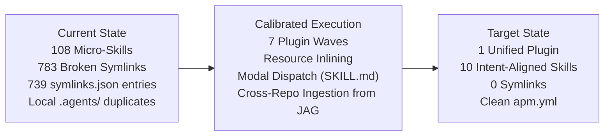

# SharePoint Knowledge Workbench: APM Migration & Skill Consolidation Plan

**Repository Target:** `sharepoint-knowledge-workbench` (`../sharepoint-knowledge-workbench`)  
**Parent Foundation:** `agent-plugins-skills` (`docs/plans/apm_migration_plan.md` §14)  
**Active Feature Branch:** `feat/apm-migration-and-skill-consolidation` (in `sharepoint-knowledge-workbench`)  
**Status:** IN PROGRESS (Waves 1, 2, 3, 6 Completed & Verified)  
**Date:** 2026-10-23  

---

## 1. High-Level Plan & Strategic Objectives

The objective is to modernize `sharepoint-knowledge-workbench` by applying the battle-tested APM packaging and skill-consolidation model proven in `agent-plugins-skills` (PRs #715–#724).



### The 5 Strategic Pillars:
1. **Leverage Global APM (Zero Local Duplicates):**
   Downstream projects do not vendor or locally duplicate the core Agentic OS, dev-utils, memory, authoring, or orchestration plugins. All 30 platform skills are consumed directly from the global workstation profile (`~/.apm/apm.yml`).
2. **Eliminate All Symlinks via Self-Contained Spokes:**
   The 783 relative symlinks (`../../../references/...`, `../../../scripts/...`) inside skills break when APM installs them. Every script and reference needed by a skill moves **directly into that skill's own directory** (`plugins/<plugin>/skills/<skill>/scripts/` and `references/`).
3. **Consolidate 108 Micro-Skills into 10 Intent-Aligned Hubs (Avoid Overcollapsing):**
   Group single-verb micro-tasks into domain hubs with modal execution (`SKILL.md` under 100 lines dispatching to `references/modes/<mode>.md`). Ensure high-frequency user intents (e.g., *"create document library"*, *"publish page"*, *"create copilot agent"*) have dedicated, unmistakable skills rather than being buried in monolithic black boxes.
4. **Cross-Repository Ingestion from Consuming Repositories (`external-sp-migration-project`):**
   Absorb proven generic SharePoint engines (CKEditor 5 HTML sanitization, declarative navigation sync, webpart mapping catalogs, and resumable migration ledgers) from `external-sp-migration-project` into the canonical workbench so downstream projects can consume them via APM.
5. **Standardize on APM in a Unified Plugin:**
   Retire `symlinks.json`, `plugin-sources.json`, `plugin-retention.json`, and `skills-lock.json`. Unify into a single `sharepoint-workbench` plugin governed by a native `apm.yml`.

---

## 2. Zero Functional Loss & Feature Parity Protocol

Consolidation does **NOT** rewrite, delete, or degrade any underlying automation or script capability.

### 2.1 The Scripts Stay 100% Identical
- All PowerShell (`.ps1`) and Python (`.py`) scripts (e.g., `New-SharePointList.ps1`, `extract_docx.py`, `Get-WorkbenchConnectionConfig.ps1`, `publish-spo-page.ps1`) remain intact with identical arguments, parameters, return codes, and business logic.
- They move from plugin-root into the skill's `scripts/` folder, eliminating broken relative symlinks.

### 2.2 The 3-Link Awareness Chain: Why Capabilities Are Never Lost
When an engineer asks an agent to perform a specific action (e.g., *"create document library"*, *"publish page"*, *"add choice column"*), the agent navigates a 3-link chain:

```
[User Prompt: 'Create document library Invoices with versioning']
      │
      ▼ (Link 1: Top-Level Frontmatter Match)
[SKILL.md YAML description]  <-- Matches 'create document library', 'add library'
      │
      ▼ (Link 2: In-Skill Disambiguation Table)
[SKILL.md Router Table]      <-- Points directly to references/modes/create-library.md
      │
      ▼ (Link 3: Full Procedural Instruction)
[references/modes/<mode>.md] <-- Contains exact flags, PowerShell parameters, edge cases, examples
```

1. **Top-Level YAML Frontmatter (`description`):** Broad and descriptive. Explicitly enumerates all primary verbs, nouns, and aliases so the LLM triggers the right skill without hesitation.
2. **Router Table in `SKILL.md`:** A crisp lookup table mapping user intent to mode instructions.
3. **Mode Reference (`references/modes/*.md`):** Contains the verbatim micro-skill instructions, exact script parameters, constraints, examples, and verification rules.

### 2.3 Interactive Wizard Skills (Human-in-the-Loop Pipelines)
Unlike simple CLI runners, skills that absorb former orchestrator agents are built as **Interactive Wizard Skills** with guided multi-turn intake and explicit confirmation gates:
- **`converting-sharepoint-documents`:** DOCX parse ➡️ AST structure analysis ➡️ **`[Human Gate: Confirm Heading Splits]`** ➡️ Canonical assembly ➡️ Template render ➡️ **`[Human Gate: Review Rendered Topics]`**.
- **`modernizing-sharepoint-pages`:** Exported ASPX intake ➡️ Webpart scan ➡️ **`[Human Gate: Web Part Mapping Decision — SPFx vs Text]`** ➡️ Canvas layout plan ➡️ Dry-run preview ➡️ **`[Human Gate: Review Rendered Page before SPO publish]`**.
- **`migrating-sharepoint-sites`:** Dependency discovery ➡️ Matrix completeness check ➡️ Topological sort ➡️ **`[Human Gate: Confirm Deployment Order]`** ➡️ Batch list/item migration with resumable ledger.
- **`assessing-sharepoint-sites`:** Interactive intake (Site URL, credentials, traversal depth) ➡️ Scope confirmation ➡️ Non-destructive scan ➡️ Assessment report.

---

## 3. Wave 4: Complete 35-Skill Mapping Table (`sharepoint-site-build-and-publish`)

To prevent overcollapsing and guarantee that operations like *"create document library"*, *"publish page"*, and *"add list column"* never cross-cannibalize or get lost, the 35 micro-skills in `sharepoint-site-build-and-publish` map to **3 distinct, intent-aligned skills**:
1. **`managing-sharepoint-lists-and-libraries`** (Containers & List-level operations)
2. **`publishing-sharepoint-pages`** (Web content publishing & page deployment)
3. **`managing-sharepoint-schema`** (Site collection information architecture & PnP provisioning)

| # | Current Micro-Skill | Proposed Consolidated Skill | Internal Reference File | Trigger Keywords in YAML / Router | Backing Script / Operation |
|:---|:---|:---|:---|:---|:---|
| 1 | `sharepoint-create-list` | **`managing-sharepoint-lists-and-libraries`** | `references/modes/create-list.md` | `"create list"`, `"new list"`, `"custom list"` | `New-PnPList` |
| 2 | `sharepoint-remove-list` | **`managing-sharepoint-lists-and-libraries`** | `references/modes/remove-list.md` | `"delete list"`, `"remove list"` | `Remove-PnPList` |
| 3 | `sharepoint-create-document-library` | **`managing-sharepoint-lists-and-libraries`** | `references/modes/create-library.md` | `"create document library"`, `"new library"` | `New-PnPList -Template DocumentLibrary` |
| 4 | `sharepoint-configure-library-settings` | **`managing-sharepoint-lists-and-libraries`** | `references/modes/library-settings.md` | `"library versioning"`, `"require checkout"` | `Set-PnPList` |
| 5 | `sharepoint-update-list-settings` | **`managing-sharepoint-lists-and-libraries`** | `references/modes/list-settings.md` | `"update list settings"`, `"list title"` | `Set-PnPList` |
| 6 | `sharepoint-add-list-column` | **`managing-sharepoint-lists-and-libraries`** | `references/modes/add-list-column.md` | `"add list column"`, `"add column to list"` | `Add-PnPField -List` |
| 7 | `sharepoint-update-list-column` | **`managing-sharepoint-lists-and-libraries`** | `references/modes/update-list-column.md` | `"update list column"`, `"modify column"` | `Set-PnPField -List` |
| 8 | `sharepoint-remove-list-column` | **`managing-sharepoint-lists-and-libraries`** | `references/modes/remove-list-column.md` | `"remove list column"`, `"delete column"` | `Remove-PnPField -List` |
| 9 | `sharepoint-create-list-view` | **`managing-sharepoint-lists-and-libraries`** | `references/modes/create-list-view.md` | `"create list view"`, `"new view"`, `"filter view"` | `Add-PnPView` |
| 10 | `sharepoint-add-list-item` | **`managing-sharepoint-lists-and-libraries`** | `references/modes/add-list-item.md` | `"add list item"`, `"insert row"`, `"new item"` | `Add-PnPListItem` |
| 11 | `sharepoint-reconcile-calendar-list` | **`managing-sharepoint-lists-and-libraries`** | `references/modes/reconcile-calendar.md` | `"calendar list"`, `"reconcile calendar"` | `reconcile_calendar_list.py` |
| 12 | `sharepoint-download-file` | **`managing-sharepoint-lists-and-libraries`** | `references/modes/file-transfer.md` | `"download file"`, `"upload file"`, `"get file"` | `Get-PnPFile` / `Add-PnPFile` |
| 13 | `sharepoint-publish-markdown-files` | **`publishing-sharepoint-pages`** | `references/modes/publish-markdown.md` | `"publish markdown"`, `"deploy markdown pages"` | `publish_markdown_files.py` |
| 14 | `sharepoint-publish-html-page` | **`publishing-sharepoint-pages`** | `references/modes/publish-html-page.md` | `"publish html page"`, `"upload static page"` | `publish_html_page.py` |
| 15 | `sharepoint-copy-page-between-sites` | **`publishing-sharepoint-pages`** | `references/modes/copy-page.md` | `"copy page"`, `"duplicate page across sites"` | `Copy-PnPFile` |
| 16 | `sharepoint-plan-page-publication` | **`publishing-sharepoint-pages`** | `references/modes/plan-publication.md` | `"plan page publication"`, `"publication diff"` | `plan_page_publication.py` |
| 17 | `sharepoint-apply-page-publication-plan`| **`publishing-sharepoint-pages`** | `references/modes/apply-publication.md` | `"apply publication plan"`, `"deploy pages"` | `apply_page_publication_plan.py` |
| 18 | `sharepoint-validate-publication` | **`publishing-sharepoint-pages`** | `references/modes/validate-publication.md` | `"validate publication"`, `"check page health"`| `validate_publication.py` |
| 19 | `sharepoint-compare-publication-state` | **`publishing-sharepoint-pages`** | `references/modes/compare-publication.md` | `"compare publication state"`, `"page drift"` | `compare_publication_state.py` |
| 20 | `sharepoint-remove-publication` | **`publishing-sharepoint-pages`** | `references/modes/remove-publication.md` | `"unpublish page"`, `"remove published page"` | `Remove-PnPFile` |
| 21 | `sharepoint-create-site-column` | **`managing-sharepoint-schema`** | `references/modes/create-site-column.md` | `"create site column"`, `"new site column"` | `Add-PnPSiteColumn` |
| 22 | `sharepoint-update-site-column` | **`managing-sharepoint-schema`** | `references/modes/update-site-column.md` | `"update site column"`, `"modify site column"`| `Set-PnPField` |
| 23 | `sharepoint-remove-site-column` | **`managing-sharepoint-schema`** | `references/modes/remove-site-column.md` | `"remove site column"`, `"delete site column"`| `Remove-PnPField` |
| 24 | `sharepoint-create-content-type` | **`managing-sharepoint-schema`** | `references/modes/create-content-type.md` | `"create content type"`, `"new site content type"`| `Add-PnPContentType` |
| 25 | `sharepoint-update-content-type` | **`managing-sharepoint-schema`** | `references/modes/update-content-type.md` | `"update content type"`, `"add column to content type"`| `Set-PnPContentType` |
| 26 | `sharepoint-remove-content-type` | **`managing-sharepoint-schema`** | `references/modes/remove-content-type.md` | `"remove content type"`, `"delete content type"`| `Remove-PnPContentType` |
| 27 | `sharepoint-detach-content-type` | **`managing-sharepoint-schema`** | `references/modes/detach-content-type.md` | `"detach content type"`, `"unbind content type"`| `Remove-PnPContentTypeFromList` |
| 28 | `sharepoint-configure-column-formatting`| **`managing-sharepoint-schema`** | `references/modes/column-formatting.md` | `"column formatting"`, `"custom json formatter"`| `Set-PnPField -CustomFormatter` |
| 29 | `sharepoint-plan-column-changes` | **`managing-sharepoint-schema`** | `references/modes/plan-columns.md` | `"plan column changes"`, `"column diff"` | `plan_column_changes.py` |
| 30 | `sharepoint-plan-content-type-changes` | **`managing-sharepoint-schema`** | `references/modes/plan-content-types.md` | `"plan content type changes"` | `plan_content_type_changes.py` |
| 31 | `sharepoint-compare-schema-definitions` | **`managing-sharepoint-schema`** | `references/modes/compare-schema.md` | `"compare schema"`, `"schema diff"` | `compare_schema_definitions.py` |
| 32 | `sharepoint-scaffold-schema-definition` | **`managing-sharepoint-schema`** | `references/modes/scaffold-schema.md` | `"scaffold schema"`, `"new schema definition"` | `scaffold_schema_definition.py` |
| 33 | `sharepoint-reconcile-site-schema` | **`managing-sharepoint-schema`** | `references/modes/reconcile-schema.md` | `"reconcile schema"`, `"sync site schema"` | `reconcile_site_schema.py` |
| 34 | `sharepoint-generate-schema-definition-from-export` | **`managing-sharepoint-schema`** | `references/modes/export-schema.md` | `"export schema"`, `"generate schema definition"`| `generate_schema_from_export.py` |
| 35 | `sharepoint-apply-provisioning-plan` | **`managing-sharepoint-schema`** | `references/modes/apply-provisioning.md` | `"apply provisioning plan"`, `"provision site"`| `Apply-PnPProvisioningTemplate` |

---

## 4. Wave 7: Copilot Agents & Skills (`managing-sharepoint-copilot-agents-and-skills`)

In Microsoft 365 Copilot for SharePoint, an **Agent** (declarative assistant grounded in knowledge) and a **Skill** (action/API capability extension) are unified under the single domain hub: **`managing-sharepoint-copilot-agents-and-skills`**, organized internally into two distinct tracks:

### Track A: Declarative Copilot Agents
- **Scope (8 skills):** `sharepoint-create-agent-package`, `sharepoint-create-agent-package-from-template`, `sharepoint-create-agent-template`, `sharepoint-inspect-agent-knowledge`, `sharepoint-prepare-agentassets-library`, `sharepoint-backup-agents`, `sharepoint-restore-agents`, `sharepoint-update-agent-package`.
- **Triggers:** `"create copilot agent"`, `"package agent"`, `"ground agent on library"`, `"prepare agentassets"`, `"backup agents"`, `"restore agents"`.
- **Modes:** `create-agent`, `apply-template`, `configure-knowledge`, `provision-agentassets`, `backup-restore-agents`.

### Track B: Native Copilot Skills (Action Extensions)
- **Scope (6 skills):** `sharepoint-create-native-skill`, `sharepoint-deploy-native-skill`, `sharepoint-verify-native-skill`, `sharepoint-undeploy-native-skill`, `sharepoint-backup-native-skills`, `sharepoint-restore-native-skills`.
- **Triggers:** `"create copilot skill"`, `"deploy native skill"`, `"verify skill probe"`, `"undeploy skill"`, `"rollback skill"`, `"backup native skills"`.
- **Modes:** `scaffold-skill`, `deploy-skill`, `verify-skill-probe`, `undeploy-rollback-skill`, `backup-restore-skills`.

---

## 5. Wave 5: Page Modernization vs. Data Migration (`sharepoint-site-migration`)

The 20 micro-skills in `sharepoint-site-migration` split naturally along the boundary between **editorial UX page transformation** and **bulk data engineering**:

### 5.1 `modernizing-sharepoint-pages` (10 skills)
- **Scope:** Classic ASPX parsing, web part transformations, modern page rendering, image extraction, and page-level link repair.
- **Modes:** `aspx-to-html`, `convert-modern`, `rewrite-links`, `image-replacement`, `preview`, `validate-modernization`.
- **Interactive Character:** Absorbs `sharepoint-modernization-agent` and `sharepoint-webpart-modernization-analysis-agent` for guided web part disposition decisions.

### 5.2 `migrating-sharepoint-sites` (10 skills)
- **Scope:** Migration inventory, dependency graphs, batch list item migration, wave scaffolding, and document link rewriting.
- **Modes:** `inventory-normalize`, `dependency-analysis`, `wave-plan`, `migrate-lists`, `audit-migration`.
- **Interactive Character:** Absorbs `sharepoint-deployment-planning-agent` and `sharepoint-deployment-sequencing-agent` for topological ordering and completeness gates.

---

## 6. Cross-Repository Ingestion from Consuming Repositories (`external-sp-migration-project`)

Analysis of `/Users/richardfremmerlid/Projects/external-sp-migration-project/plugins/sp-migration/skills/` reveals high-value, battle-tested SharePoint engines that belong in the canonical workbench.

### 6.1 Generic Engines Moving to the Workbench Now
1. **CKEditor 5 HTML Sanitization & Linter (`sp-text-webpart-html`):**
   - Ingests `sp_text_webpart_html.py`, `convert-package-to-rte.ps1`, `assets/rte-vocabulary.json`, and all 6 reference guides into **`publishing-sharepoint-pages`** and **`modernizing-sharepoint-pages`**.
   - Solves modern SharePoint CKEditor 5 dropping custom HTML and formatting on page edit.
2. **Declarative Navigation Provisioning (`sp-navigation-sync`):**
   - Ingests `export-spo-navigation.ps1`, `sync-spo-navigation.ps1`, `navigation_plan.py`, and acceptance criteria into **`publishing-sharepoint-pages`** (as `mode: sync-navigation`).
   - Adds missing export, diff, dry-run, and idempotent PnP top/quick-launch menu provisioning.
3. **Classic-to-Modern Webpart Catalog (`sp-dynamic-aspx-page-migration` core):**
   - Ingests `spo-webparts.json`, `dynamic-page-webpart-mapping.md`, `dynamic-page-layout-and-columns.md`, and `extract-page-images.ps1` into **`modernizing-sharepoint-pages`**.
   - Canonical reference mapping classic webparts (Content Editor, Script Editor, Summary Links, List View) to modern client-side webparts and canvas sections.
4. **Resumable Library Migration Ledger (`sp-document-library-upload` core):**
   - Ingests `library_migration_ledger.py` and `migration_status_tracker.py` into **`migrating-sharepoint-sites`**.
5. **Modern Page Publication Engine (`sp-page-publish`):**
   - Ingests `publish-spo-page.ps1` into **`publishing-sharepoint-pages`**.

### 6.2 Project-Specific Skills Staying in `external-sp-migration-project`
These 4 skills remain strictly inside `external-sp-migration-project` because they are tightly coupled to project governance, specific spreadsheets, and release gates:
- `sp-migration-register-reconcile` (coupled to Consumer Jira/register)
- `sp-migration-release-readiness` (coupled to Consumer cutover go/no-go criteria)
- `sp-migration-wave-execution` (coupled to Consumer wave batch folders and schedules)
- `sp-page-inventory` (coupled to `source-sp-tenant.example.com` manifest format and `page-migration-tracker.xlsx`)

---

## 7. Master Status & Execution Waves

| Wave | Plugin Scope | Source Micro-Skills | Target Consolidated Hubs | Status | Verification Result |
| :---: | :--- | :---: | :--- | :---: | :--- |
| **1** | `sharepoint-workbench-setup` | 5 | `setting-up-sharepoint-workbench` | **DONE** | 96 tests passed |
| **2** | `sharepoint-site-assessment` | 12 | `assessing-sharepoint-sites` | **DONE** | 179 tests passed |
| **3** | `sharepoint-document-conversion` | 11 | `converting-sharepoint-documents` | **DONE** | 175 tests passed |
| **6** | `sharepoint-spfx-development` | 11 | `developing-spfx-solutions` | **DONE** | 10 tests passed |
| **7** | `sharepoint-copilot-agents-and-skills` | 14 | `managing-sharepoint-copilot-agents-and-skills` | **DONE** | 28 passed, 5 skipped (100% green); unified 2-track hub |
| **5** | `sharepoint-site-migration` | 20 | • `modernizing-sharepoint-pages`<br>• `migrating-sharepoint-sites` | **DONE** | 500 tests passed (100% green); inlines webpart catalog & ledger |
| **4** | `sharepoint-site-build-and-publish` | 35 | • `managing-sharepoint-lists-and-libraries`<br>• `publishing-sharepoint-pages`<br>• `managing-sharepoint-schema` | **RUNNING** | Active task-1298; inlines 35 micro-skills into 3 domain hubs |
| **Post**| Unified Packaging & Ingestion | — | Unified `plugins/sharepoint-workbench` & `apm.yml`, ingest `managing-sharepoint-navigation` | Queued | Final release validation |

---

## 8. Summary of Final 11-Skill Target Inventory (Unified Plugin)

When all waves complete, the unified `sharepoint-workbench` plugin will contain **11 sharp, self-contained domain skills**:

1. **`setting-up-sharepoint-workbench`** (Auth, connections, profiles)
2. **`assessing-sharepoint-sites`** (Discovery, permissions, webpart scan, audit report)
3. **`converting-sharepoint-documents`** (Interactive Word/PDF ➡️ AST ➡️ render wizard)
4. **`developing-spfx-solutions`** (SPFx toolchain, scaffolding, packaging, app catalog)
5. **`managing-sharepoint-lists-and-libraries`** (Lists, document libraries, views, settings, files)
6. **`publishing-sharepoint-pages`** (Modern pages, HTML/markdown deployment, CKEditor 5 RTE formatting)
7. **`managing-sharepoint-schema`** (Site columns, site content types, column formatting, PnP templates)
8. **`managing-sharepoint-navigation`** (Dedicated declarative Excel ↔ SPO menu sync from external migration project)
9. **`modernizing-sharepoint-pages`** (Interactive classic ASPX ➡️ modern canvas conversion wizard with `spo-webparts.json`)
10. **`migrating-sharepoint-sites`** (Interactive dependency sequencing ➡️ wave ledger data migration)
11. **`managing-sharepoint-copilot-agents-and-skills`** (Copilot declarative agents, knowledge grounding, native skill actions)

Plus **1 sub-agent**:
* **`sharepoint-validation-agent`** (Adversarial read-only reviewer for audit reports).

---

## 9. Documentation, Link Integrity & Master Migration Inventory

Just as executed in `agent-plugins-skills` (PR #723), all historical names of skills, scripts, plugins, resources, and assets must be tracked in a master migration inventory:

1. **Master Migration Inventory (`docs/plans/master_migration_inventory.csv`):**
   - Records every retired micro-skill path, its new consolidated skill spoke path, and the mode reference file.
   - Records all re-homed scripts and assets.
2. **Deterministic Cross-File Reference Audit:**
   - Execute a comprehensive regex sweep across all `.md`, `.py`, `.ps1`, `.json`, and `.mmd` Mermaid diagrams in the repository.
   - Repoint all stale micro-skill paths (e.g. `plugins/.../skills/sharepoint-create-list/SKILL.md`) to the new consolidated spoke paths (e.g. `plugins/.../skills/managing-sharepoint-lists-and-libraries/references/modes/create-list.md`).
   - Verify zero dead links using `plugins/agent-extension-authoring/skills/authoring-skills/scripts/audit_skill.py`.

---

## 10. Pre-Completion & Reference Parity Verification Gate

Before any wave is marked complete, it must satisfy the 4-point verification contract:

1. **Feature & Reference Parity:**
   - Every single source micro-skill has a verbatim mode instruction file under `references/modes/<mode>.md`.
   - All associated assets, templates, and schemas are materialized with zero symlinks.
2. **Interactive Wizard Fidelity:**
   - Multi-turn skills (`converting-sharepoint-documents`, `modernizing-sharepoint-pages`, `migrating-sharepoint-sites`) retain explicit user confirmation gates and dry-run preview steps.
3. **Broad YAML Triggering:**
   - Frontmatter `description` contains all primary natural-language keywords and command aliases from the merged skills.
4. **Test Suite Verification:**
   - 100% of pytest test suites pass without regression.

---

## 11. Active Execution State & Session Handoff Brief

If this task is handed off to a subsequent agent session:
- **Active Branch:** `feat/apm-migration-and-skill-consolidation` in `sharepoint-knowledge-workbench`.
- **Completed Waves:** Waves 1, 2, 3, 5, 6, 7 are verified and 100% green (1,009 passed tests total across completed plugins).
- **Active Wave:** Wave 4 (`sharepoint-site-build-and-publish`) is running under task-1298.
- **Immediate Next Actions upon Wave 4 completion:**
  1. Audit Wave 4 results (run `pytest plugins/sharepoint-site-build-and-publish/tests/` and verify the 3 hubs).
  2. Ingest `managing-sharepoint-navigation` and `sp-text-webpart-html` assets from `../jag-csb-intranet`.
  3. Fold the completed skills into the unified plugin directory: `plugins/sharepoint-workbench/`.
  4. Generate root `apm.yml` and retire `symlinks.json`, `plugin-sources.json`, `plugin-retention.json`.
  5. Run the master migration inventory cross-file sweep and open the PR!
