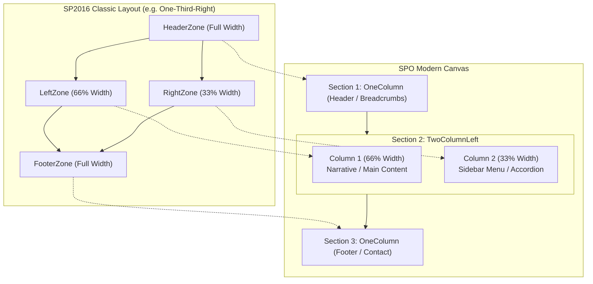

# Dynamic Page Migration: Layout, Section Templates, and Column Mapping

Governs how SharePoint 2016 page layouts and web part zones map to SharePoint Online modern canvas section templates, multi-column layouts, and component column assignments.

---

## Contents

- [Overview & Architecture](#overview--architecture)
- [Legacy Layouts vs Modern Section Templates](#legacy-layouts-vs-modern-section-templates)
- [Layout Archetypes & Use Cases](#layout-archetypes--use-cases)
- [SPFx Accordion Column Density](#spfx-accordion-column-density)
- [Multi-Section Page Assembly](#multi-section-page-assembly)
- [Planner & Publication Contract](#planner--publication-contract)
- [Validation & Review Checklist](#validation--review-checklist)

---

## Overview & Architecture

SharePoint 2016 classic publishing and web part pages relied on fixed server-side layout templates (`.aspx` page layouts) containing named web part zones (`Header`, `LeftZone`, `RightZone`, `Body`, `Footer`).

In SharePoint Online modern pages, layouts are structured as:
1. **Sections** (`Add-PnPPageSection`): Horizontal bands ordered from top to bottom (Section 1, 2, 3, ...). Each section has a specific **SectionTemplate** defining its column structure.
2. **Columns**: Vertical slots within each section (Column 1, 2, or 3).
3. **Web Parts** (`Add-PnPPageWebPart`, `Add-PnPPageTextPart`): Controls placed at specific `(Section, Column, Order)` coordinates.



---

## Legacy Layouts vs Modern Section Templates

The mapping from classic SP2016 layout strings (stored in `inventory\inventory-page.json` and page export XML) to modern SPO section templates is deterministic:

| SP2016 Layout | Target SPO Section Template | Column 1 Width | Column 2 Width | Column 3 Width | Typical Zone Mapping |
|---|---|---|---|---|---|
| `One-Column` | `OneColumn` | 100% | N/A | N/A | `Body` / `BodyZone` -> Col 1 |
| `One-Third-Right` | `TwoColumnLeft` | 66% (2/3) | 33% (1/3) | N/A | `LeftZone` -> Col 1, `RightZone` -> Col 2 |
| `Two-Third-Left` | `TwoColumnLeft` | 66% (2/3) | 33% (1/3) | N/A | `LeftZone` -> Col 1, `RightZone` -> Col 2 |
| `Two-Third-Right` | `TwoColumnRight` | 33% (1/3) | 66% (2/3) | N/A | `LeftZone` -> Col 2, `RightZone` -> Col 1 |
| `Two-Column` | `TwoColumn` | 50% (1/2) | 50% (1/2) | N/A | `LeftZone` -> Col 1, `RightZone` -> Col 2 |
| `Three-Column` | `ThreeColumn` | 33% (1/3) | 33% (1/3) | 33% (1/3) | `LeftZone` -> Col 1, `CenterZone` -> Col 2, `RightZone` -> Col 3 |
| `Other` / Unrecognized | `OneColumn` | 100% | N/A | N/A | All zones stacked sequentially |

> [!IMPORTANT]
> Modern PnP PowerShell uses `TwoColumnLeft` (two-thirds left, one-third right) and `TwoColumnRight` (one-third left, two-thirds right). Do not use obsolete aliases like `TwoThirdsLeft`.

---

## Layout Archetypes & Use Cases

### 1. Pattern A: Sequential Stack (`One-Column` -> `OneColumn`)
- **Structure**: Single-column vertical flow.
- **Use Cases**: Standard procedural documents, topic pages, or pages where an accordion spans full width below an introduction.
- **Examples**: `PAS.aspx`, `JUSTIN-Training-Cyberclass-3-0.aspx`, `Family-Law-Act.aspx`.
- **Accordion Setting**: When an SPFx accordion is placed in a `OneColumn` section, set `-AccordionColumns 2` or `3` to generate an interactive, responsive button grid.

### 2. Pattern B: Asymmetric Content + Sidebar Navigation (`One-Third-Right` -> `TwoColumnLeft`)
- **Structure**: 66% main narrative on the left, 33% sidebar on the right.
- **Use Cases**: Pages where the primary content consists of narrative text or data tables in `LeftZone`, and `RightZone` hosts a collapsed accordion menu or quick resource links.
- **Example**: `Interpreters.aspx` (`LeftZone` = Home Intro & Policy text; `RightZone` = Accordion with Procedures, Language codes, Rates).
- **Component Placement**:
  - **Section 1 (OneColumn)**: Breadcrumb & Title header.
  - **Section 2 (TwoColumnLeft)**:
    - **Column 1 (66% Left)**: TextWebPart(s) from `LeftZone`.
    - **Column 2 (33% Right)**: SPFx Accordion (`bcgov-accordion`) from `RightZone`.
- **Accordion Setting**: **MUST set `-AccordionColumns 1`**. A narrow 33% column cannot accommodate a multi-column button grid; buttons must stack vertically as a clean sidebar list.

### 3. Pattern C: Asymmetric Accordion + Resource Rail (`One-Third-Right` -> `TwoColumnLeft`)
- **Structure**: 66% accordion body on the left, 33% resource/quick links rail on the right.
- **Use Cases**: Reference dossiers where primary categorized content lives in an accordion, but quick contacts, external links, or related forms live on the right rail.
- **Example**: `Judicial-Info-Registrars-Resource-Material.aspx`.
- **Component Placement**:
  - **Section 1 (OneColumn)**: Breadcrumb & Title header.
  - **Section 2 (TwoColumnLeft)**:
    - **Column 1 (66% Left)**: SPFx Accordion (`bcgov-accordion`) with `-AccordionColumns 1` or `2`.
    - **Column 2 (33% Right)**: TextWebPart(s) containing Contacts, Quick Links, and Resource PDFs from `RightZone`.

---

## SPFx Accordion Column Density

The SPFx Modern Accordion web part (`bcgov-accordion`, component ID `e8d2e61a-0357-4a0b-932d-222a0133c94d`) supports the `columns` property (integer 1, 2, or 3):

| `columns` Value | Visual Appearance | Recommended Section / Column Context |
|---|---|---|
| `1` | Single vertical stack of full-width panel buttons | **Mandatory** for 33% narrow columns (`TwoColumnLeft` Col 2, `TwoColumnRight` Col 1, `ThreeColumn`). Also suitable for sequential mobile-first pages. |
| `2` | 2-column balanced button grid | Excellent for 66% wide columns (`TwoColumnLeft` Col 1, `TwoColumnRight` Col 2) or standard desktop `OneColumn`. |
| `3` | 3-column dense button grid | Best for 100% full-width desktop `OneColumn` sections with many short-titled panels (e.g. `PAS.aspx`). |

> [!CAUTION]
> Never configure `columns: 2` or `columns: 3` when placing an accordion into a 33% narrow column. The buttons will compress, causing title truncation and layout breakage.

---

## Multi-Section Page Assembly

When converting classic pages with multiple zones or asymmetric layouts, `new-page-migration-dry-run.ps1` and `publish-spo-page.ps1` assemble the page into distinct sections:

1. **Header Section (Section 1)**:
   - Section Template: `OneColumn`
   - Content: TextWebPart with breadcrumb navigation (`Home > Administration > PageTitle`) and `<h2>` page title (BC Design System token styling).
2. **Main Content Section (Section 2)**:
   - Section Template: Derived from `Layout` (e.g. `TwoColumnLeft` for `One-Third-Right`).
   - Column 1: Components from `LeftZone` or primary content zone.
   - Column 2: Components from `RightZone` (sidebar accordion or resource links).
3. **Supplementary / Footer Section (Section 3, if present)**:
   - Section Template: `OneColumn`
   - Content: Full-width disclaimers, contact banners, or related portal links.

---

## Planner & Publication Contract

### In `plan.json`
The dry-run planner emits:
```json
{
  "Sections": [
    "OneColumn",
    "TwoColumnLeft"
  ],
  "Components": [
    {
      "OutputType": "TextWebPart",
      "Role": "PageHeader",
      "Section": 1,
      "Column": 1,
      "Order": 1
    },
    {
      "OutputType": "TextWebPart",
      "SourceZoneId": "LeftZone",
      "Section": 2,
      "Column": 1,
      "Order": 1
    },
    {
      "OutputType": "SpfxWebPart",
      "SourceZoneId": "RightZone",
      "Section": 2,
      "Column": 2,
      "Order": 1,
      "Properties": {
        "columns": 1
      }
    }
  ]
}
```

### In `publish-spo-page.ps1`
The publisher script enforces:
1. Creation of each section with its specified template:
   ```powershell
   Add-PnPPageSection -Page $page -SectionTemplate $template -Order $sectionOrder
   ```
2. Placement of each component at its exact `(Section, Column, Order)` coordinates:
   ```powershell
   Add-PnPPageWebPart -Page $page -Component $spfx -Section $section -Column $column -Order $order
   Add-PnPPageTextPart -Page $page -Text $html -Section $section -Column $column -Order $order
   ```

---

## Validation & Review Checklist

Before approving an asymmetric or multi-column page for publication:

- [ ] **Layout Match**: Did the SP2016 layout match the planned SPO section template (`One-Third-Right` -> `TwoColumnLeft`)?
- [ ] **Zone Assignment**: Are `LeftZone` web parts assigned to Column 1 and `RightZone` web parts to Column 2?
- [ ] **SPFx Accordion Density**: If the accordion is in Column 2 (narrow 33% rail), is `columns` set to `1`?
- [ ] **Breadcrumb Separation**: Is the page header/breadcrumb in an isolated `OneColumn` section above the two-column split so it spans full width?
- [ ] **Visual Verification**: Has the user verified on SPO DEV that the two columns render side-by-side on desktop without overlap?
